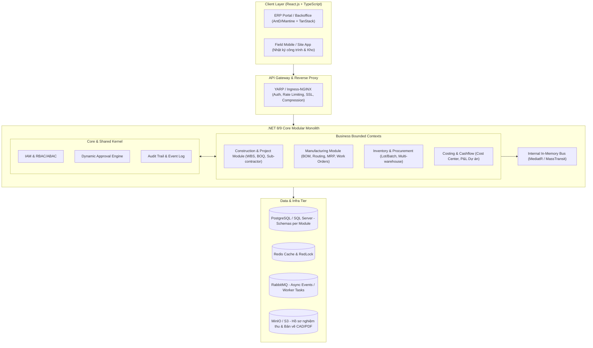
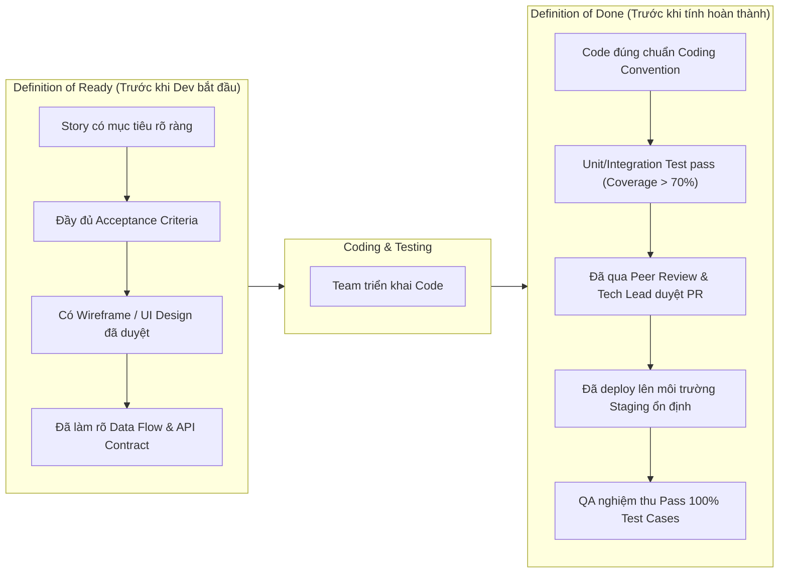

# MASTER PLAN: PHÁT TRIỂN HỆ THỐNG ERP NGÀNH XÂY DỰNG & SẢN XUẤT

> **Vị trí phụ trách**: Tech Lead / Software Architect & Lead Developer  
> **Quy mô đội ngũ**: 1 Tech Lead (50% hands-on) + 3–5 Kỹ sư (Backend, Frontend, Fullstack/DevOps)  
> **Nền tảng công nghệ chính**: .NET 8/9 Core, React.js (TypeScript), PostgreSQL/SQL Server, Redis, RabbitMQ, Docker & Kubernetes  
> **Mục tiêu**: Xây dựng hệ thống ERP chuyên sâu cho quản lý dự án công trình xây dựng, điều hành sản xuất nhà máy, kiểm soát vật tư/chi phí và luồng công việc phê duyệt tự động.

---

## 1. TỔNG QUAN HỆ THỐNG VÀ ĐỊNH HƯỚNG KIẾN TRÚC

### 1.1. Thách thức cốt lõi của bài toán ERP Xây Dựng & Sản Xuất
* **Đặc thù Xây dựng**: Quản lý phi tập trung theo công trình/gói thầu, dự toán BOQ (Bill of Quantities), quản lý tiến độ WBS (Work Breakdown Structure)/Gantt Chart, kiểm soát thất thoát vật tư tại công trường, nghiệm thu thanh quyết toán giai đoạn.
* **Đặc thù Sản xuất / Nhà máy**: Quản lý BOM (Bill of Materials) nhiều cấp, quy trình công nghệ (Routing), lệnh sản xuất (Work Order), hoạch định nhu cầu vật tư (MRP), kiểm soát chất lượng tại chuyền (IQC/PQC/FQC) và bảo trì thiết bị (OEE).
* **Bài toán chung**: Phân quyền ma trận phức tạp (theo chức vụ + theo phòng ban + theo từng dự án/công trường cụ thể), Workflow phê duyệt động nhiều cấp (Approval Engine) và tính minh bạch của Audit Trail.

---

### 1.2. Chiến lược Kiến trúc: Modular Monolith hướng Domain-Driven Design (DDD)

Với quy mô team 3–5 engineers giai đoạn đầu, **Modular Monolith** là lựa chọn tối ưu vượt trội so với Pure Microservices:
1. **Tránh bẫy Over-engineering**: Không tốn chi phí vận hành distributed transactions (2PC/Saga), latency mạng, và hạ tầng DevOps cồng kềnh.
2. **Đảm bảo tính bao đóng (High Cohesion, Low Coupling)**: Mỗi module độc lập theo Bounded Context (Core, Project, Manufacturing, Inventory, HRM, Finance), có database schema riêng hoặc table prefix riêng.
3. **Sẵn sàng tách Microservices**: Giao tiếp nội bộ qua In-Memory Event Bus (MediatR) hoặc Outbox Pattern với Message Broker (RabbitMQ). Khi một module (ví dụ: Production Realtime Tracking) cần scale độc lập, ta có thể bóc tách thành service riêng mà không phá vỡ cấu trúc.



---

## 2. STACK CÔNG NGHỆ & LỰA CHỌN KỸ THUẬT

| Lớp (Tier) | Công nghệ đề xuất | Lý do & Lợi ích kỹ thuật |
| :--- | :--- | :--- |
| **Backend Runtime** | .NET 8 / 9 (C# 12/13), ASP.NET Core Web API | Hiệu năng Top tier thế giới, Type-safe mạnh, Memory footprint thấp, hỗ trợ Long-Term Support (LTS). |
| **Architecture Pattern** | Clean Architecture + Vertical Slice + DDD | Dễ mở rộng, testable, chia việc cho team không bị xung đột code (merge conflict). |
| **ORM & Data Access** | Entity Framework Core 8/9 + Dapper | EF Core xử lý nghiệp vụ phức tạp, Change Tracking; Dapper tối ưu các query báo cáo nghìn dòng cực nhanh. |
| **Database** | PostgreSQL (v16+) hoặc SQL Server | PostgreSQL tối ưu chi phí bản quyền, hỗ trợ JSONB mạnh cho dynamic form/workflow, TimescaleDB nếu cần lưu log IOT/máy móc. |
| **Caching & Lock** | Redis (StackExchange.Redis, RedLock) | Cache danh mục vật tư, quyền hạn user; Distributed Lock chống xuất kho âm/đặt trùng đơn. |
| **Message Broker** | MassTransit + RabbitMQ | Đảm bảo Outbox Pattern, Publish/Subscribe events giữa các module, background job xử lý bất đồng bộ. |
| **Frontend Framework** | React 18/19, TypeScript, Vite | Build siêu nhanh, Type safety, hệ sinh thái phong phú cho ứng dụng Dashboard/ERP. |
| **UI Component Library** | Mantine UI hoặc Ant Design (v5) + Tailwind CSS | Đầy đủ UI Controls phức tạp cho B2B: Data Grid, DatePicker dải dài, TreeSelect, Complex Modals. |
| **Specialized UI** | TanStack Table (v8) + DHTMLX Gantt / Frappe Gantt | Hiển thị bảng dữ liệu nghìn dòng ảo hóa (Virtualization), sơ đồ tiến độ dự án chuyên nghiệp. |
| **State & Data Fetching** | TanStack Query (React Query) + Zustand | Quản lý server-state, tự động cache, revalidate, optimistic UI; Zustand quản lý state cục bộ gọn nhẹ. |
| **Form Management** | React Hook Form + Zod | Xử lý các form dự toán, nghiệm thu 50–100 trường dữ liệu mà không bị lag render. |
| **DevOps & Hosting** | Docker, Kubernetes (K8s), Helm, Ingress-NGINX | Đóng gói nhất quán từ Local -> Staging -> Production, tự động scale theo tải. |
| **CI/CD** | GitHub Actions / GitLab CI | Tự động Linting, Unit Test, SonarQube scan, Build Docker image, Deploy GitOps. |
| **Observability** | OpenTelemetry, Prometheus, Grafana, Seq / Loki | Giám sát APM thời gian thực, tập trung log lỗi, cảnh báo sớm trước khi user phát hiện. |

---

## 3. PHÂN BỔ TRÁCH NHIỆM & TỔ CHỨC ĐỘI NGŨ (TEAM 3–5 DEVS)

### 3.1. Cơ cấu nhân sự
* **1 Tech Lead (Anh/Em)**:
  * **50% Thời gian**: Trực tiếp code module lõi (Core Framework, Dynamic Workflow, Security, Performance tuning, Outbox/Event Bus).
  * **20% Thời gian**: Review PR hằng ngày (bắt buộc trước khi merge), giải quyết technical debt, refactor code.
  * **20% Thời gian**: Làm việc với PM/PO/BA/QA (Sprint Planning, Grooming, Poker estimation, Kiến trúc DB).
  * **10% Thời gian**: DevOps/K8s, Mentoring, 1-on-1, đào tạo kỹ thuật cho team.
* **1-2 Backend Developers (1 Senior + 1 Mid)**:
  * Senior BE: Đảm nhiệm module Xây dựng (WBS, BOQ, Hợp đồng) + Kho vật tư.
  * Mid BE: Đảm nhiệm module Sản xuất (BOM, Routing, Lệnh sản xuất) + Báo cáo xuất nhập tồn.
* **1-2 Frontend Developers (1 Senior + 1 Mid)**:
  * Senior FE: Thiết lập UI Architecture, Design System, Custom Gantt Chart, Reusable Data Table, Dynamic Form Builder.
  * Mid FE: Phát triển các màn hình CRUD nghiệp vụ, Dashboard chỉ số, Báo cáo tiến độ, Tích hợp API.
* **1 QA/QC (Manual + Automation cơ bản)**: Viết Test Case, test nghiệp vụ song song từng Sprint, chặn bug trước khi lên Staging.

---

### 3.2. Chiến lược phân bổ 50% Coding của Tech Lead
Để không bị cuốn vào "họp hành triền miên" làm mất 50% thời gian code, Tech Lead cần "giữ chốt" các hạng mục kỹ thuật mang tính xương sống:

| Khu vực Tech Lead trực tiếp code | Khu vực ủy quyền cho Team phát triển |
| :--- | :--- |
| 1. Base Framework (.NET Solution Template, Result Pattern, Global Error Handling, Auditing Interceptor). | 1. Các API CRUD chuẩn cho danh mục (Khách hàng, NCC, Vật tư, Phòng ban). |
| 2. Dynamic Workflow Engine (Xử lý State Machine cho luồng phê duyệt đa cấp nhiều điều kiện). | 2. Giao diện các màn hình nhập liệu, form chi tiết theo wireframe đã chuẩn hóa. |
| 3. IAM, Multi-tenancy Isolation & Ma trận phân quyền RBAC/ABAC sâu đến từng dòng dữ liệu (Row-level Security). | 3. Viết Business Logic thông thường theo use-case (Ví dụ: Thêm mới phiếu đề xuất vật tư). |
| 4. Kiến trúc Outbox Pattern, Message Consumers với RabbitMQ/MassTransit. | 4. Báo cáo thống kê, xuất Excel/PDF cơ bản (dùng ClosedXML / QuestPDF). |
| 5. Thiết lập CI/CD pipeline, K8s manifests, Dockerfile multi-stage, Script DB migration. | 5. Viết Unit test và Integration test cho các use-case nghiệp vụ thông thường. |

---

## 4. LỘ TRÌNH TRIỂN KHAI THEO GIAI ĐOẠN (ROADMAP 0 -> 1)

```
[Phase 0: 4 Tuần] Foundation, Framework, Architecture & CI/CD
       │
[Phase 1: 8 Tuần] Core Platform, Master Data & Dynamic Approval Engine
       │
[Phase 2: 8 Tuần] Construction & Project Management (WBS, BOQ, Công trường)
       │
[Phase 3: 8 Tuần] Manufacturing & Factory Operations (BOM, MRP, Lệnh SX)
       │
[Phase 4: 6 Tuần] Integration, Costing, BI Analytics, Load Test & Golive Thí Điểm
```

### PHASE 0: FOUNDATION, ARTIFACTS & SETUP PIPELINE (Tháng 1 - Sprint 1 & 2)
* **Mục tiêu**: Dựng toàn bộ móng vững chắc, thống nhất tiêu chuẩn code, setup môi trường tự động hóa hoàn toàn.
* **Công việc cụ thể**:
  1. **Architecture & Standards**:
     * Khởi tạo Repository Monorepo hoặc Multi-repo chuẩn.
     * Thiết lập Clean Architecture: `Domain`, `Application`, `Infrastructure`, `Api`.
     * Cài đặt EditorConfig, ESLint, Prettier, Husky (Git pre-commit hooks), C# Roslyn Analyzers.
     * Thiết lập Pipeline CI/CD: Tự động chạy test và linter khi mở Pull Request; build docker image khi merge `develop`.
  2. **Core Tech Boilerplate (Tech Lead làm)**:
     * Tích hợp Authentication (JWT / Refresh Token / OpenIddict hoặc Keycloak).
     * EF Core Base Entity (Id, CreatedAt, CreatedBy, UpdatedAt, IsDeleted - Soft Delete, RowVersion - Concurrency control).
     * Interceptor tự động ghi Audit Log mọi thay đổi DB vào bảng `AuditTrails`.
     * Setup môi trường Dev/Staging trên Kubernetes cluster (Minikube/K3s nội bộ hoặc Cloud AKS/EKS/GKE).
  3. **Quy trình Team**:
     * Thiết lập bảng Kanban/Scrum (Jira hoặc Azure DevOps).
     * Thống nhất **Definition of Ready (DoR)** và **Definition of Done (DoD)**.
     * Workshop đào tạo team về Clean Architecture, CQRS với MediatR, React Query.

---

### PHASE 1: CORE PLATFORM, MASTER DATA & APPROVAL ENGINE (Tháng 2 & 3 - Sprint 3 đến 6)
* **Mục tiêu**: Xây dựng xong nền tảng quản trị người dùng, danh mục dùng chung và động cơ phê duyệt đa cấp.
* **Modules & Features**:
  1. **IAM & Permission System**:
     * Quản lý Người dùng, Vai trò, Phòng ban, Phân xưởng/Chi nhánh/Công trình.
     * Phân quyền 3 lớp: Menu permission (FE), Action permission (API Policy), Data scope permission (ví dụ: Chỉ huy trưởng chỉ thấy dữ liệu công trình mình phụ trách).
  2. **Master Data Engine**:
     * Danh mục Vật tư/Hàng hóa (Mã số, quy cách, đơn vị tính quy đổi, định mức tồn an toàn).
     * Danh mục Đối tác (Khách hàng, Nhà cung cấp, Nhà thầu phụ, Đội thợ khoán).
     * Hệ thống Kho đa tầng (Kho tổng, Kho xưởng sản xuất, Kho công trình).
  3. **Workflow & Approval Engine (Module lõi - Tech Lead chủ trì)**:
     * Bộ máy phê duyệt động: Định nghĩa luồng (Nhiều cấp, duyệt song song hoặc tuần tự, duyệt theo hạn mức giá trị).
     * Trạng thái phiếu: Draft -> Submitted -> Pending Approval -> Approved / Rejected -> Closed.
     * Tích hợp Notification đa kênh (Web in-app notification via SignalR, Email, Telegram/Zalo ZNS).

---

### PHASE 2: MODULE QUẢN LÝ DỰ ÁN & CÔNG TRÌNH XÂY DỰNG (Tháng 4 & 5 - Sprint 7 đến 10)
* **Mục tiêu**: Tin học hóa toàn diện việc quản lý công trình từ lập dự toán đến giám sát thi công thực tế.
* **Modules & Features**:
  1. **Dự toán & Ngân sách công trình (BOQ - Bill of Quantities)**:
     * Import bảng dự toán từ Excel/CAD vào hệ thống; phân bổ ngân sách cho từng hạng mục công việc.
     * Quản lý giá thầu và kiểm soát vượt ngân sách (Budget Overrun Alert).
  2. **Quản lý Tiến độ (WBS & Interactive Gantt Chart)**:
     * Cây phân rã công việc WBS nhiều cấp (Giai đoạn -> Hạng mục -> Công việc cụ thể).
     * Gantt Chart tương tác trên React (kéo thả phụ thuộc FS, SS, FF, SF, đường găng Critical Path).
     * Giao việc cho Kỹ sư hiện trường / Đội thi công; báo cáo tiến độ % hoàn thành.
  3. **Nhật ký công trình & Báo cáo hiện trường (Site Daily Log)**:
     * Ứng dụng Web Mobile/PWA cho giám sát công trường: Báo cáo thời tiết, số lượng công nhân, máy móc hoạt động, phát sinh sự cố.
     * Chụp ảnh hiện trường đính kèm GPS/Timestamp lưu trữ S3.
  4. **Quản lý Vật tư Công trình & Hao hụt**:
     * Đề xuất vật tư theo tiến độ -> Phê duyệt -> Xuất kho chuyển đến công trường.
     * Đối chiếu định mức dự toán với thực tế cấp phát; cảnh báo hao hụt vượt tiêu chuẩn.
  5. **Nghiệm thu & Thanh toán (Billing & Milestones)**:
     * Hồ sơ nghiệm thu công việc nội bộ và nghiệm thu A-B (Chủ đầu tư - Nhà thầu).
     * Đề nghị thanh toán theo giai đoạn, giữ lại tiền bảo hành công trình.

---

### PHASE 3: MODULE SẢN XUẤT & ĐIỀU HÀNH NHÀ MÁY (Tháng 6 & 7 - Sprint 11 đến 14)
* **Mục tiêu**: Quản lý chuỗi sản xuất khép kín: Hoạch định -> Ra lệnh -> Thực thi tại chuyền -> Kiểm soát chất lượng.
* **Modules & Features**:
  1. **Định mức Sản xuất (BOM) & Quy trình Công nghệ (Routing)**:
     * Quản lý BOM nhiều tầng (Cụm chi tiết -> Chi tiết nhỏ -> Nguyên vật liệu thô).
     * Định nghĩa Routing (Quy trình sản xuất qua các công đoạn: Cắt, Hàn, Sơn, Lắp ráp, Đóng gói).
     * Thời gian chuẩn định mức (Standard Cycle Time) và chi phí nhân công/máy móc.
  2. **Kế hoạch Sản xuất & Nhu cầu Vật tư (MPS & MRP)**:
     * Lập kế hoạch sản xuất chính (Master Production Schedule) dựa trên Đơn đặt hàng hoặc Dự báo.
     * Chạy thuật toán MRP: Tính toán chính xác lượng nguyên vật liệu cần mua và thời điểm cần có để tránh gián đoạn sản xuất.
  3. **Lệnh Sản xuất (Work Orders / Job Orders)**:
     * Phát hành Lệnh sản xuất xuống từng phân xưởng, tổ đội, máy móc.
     * Cấp phát nguyên vật liệu từ kho sản xuất theo đúng định mức BOM của lệnh.
     * Cập nhật sản lượng hoàn thành từng ca/kíp (Terminal màn hình cảm ứng hoặc mã vạch/QR Code).
  4. **Quản lý Chất lượng (QC Engine)**:
     * Kiểm tra nguyên liệu đầu vào (IQC - Input Quality Control).
     * Kiểm tra bán thành phẩm tại chuyền (PQC - In-Process Quality Control).
     * Kiểm tra thành phẩm trước khi nhập kho (FQC - Final Quality Control).
     * Ghi nhận phế phẩm, nguyên nhân lỗi và quy trách nhiệm xử lý (Rework / Scrap).
  5. **Bảo trì Thiết bị & Quản lý Máy móc cơ bản (TPM)**:
     * Danh mục tài sản, máy móc thiết bị nhà xưởng; lịch bảo trì phòng ngừa định kỳ.
     * Ghi nhận thời gian dừng máy sự cố (Downtime) tính toán chỉ số khả dụng máy móc.

---

### PHASE 4: TÍCH HỢP DÒNG TIỀN, BI DASHBOARD, LOAD TEST & GOLIVE (Tháng 8 & 9 - Sprint 15 đến 18)
* **Mục tiêu**: Báo cáo tài chính quản trị, tối ưu hiệu năng toàn diện, nghiệm thu UAT tại nhà máy/công trường thật và Go-live.
* **Modules & Features**:
  1. **Chi phí & Dòng tiền Dự án/Nhà xưởng (Costing & P&L)**:
     * Tập hợp chi phí thực tế 3 yếu tố: Chi phí NVL trực tiếp + Chi phí Nhân công trực tiếp + Chi phí Sản xuất/Thi công chung.
     * So sánh chi phí Kế hoạch vs Thực tế; Báo cáo Lãi/Lỗ (P&L) theo từng hợp đồng dự án / từng lô sản xuất.
  2. **Executive BI Dashboard**:
     * Dashboard thời gian thực cho Ban Lãnh đạo: Tỷ lệ tiến độ tổng thể các công trình, Hiệu suất nhà máy, Công nợ khách hàng/NCC, Cảnh báo dòng tiền.
  3. **Hardening, Security & Load Testing (Tech Lead chủ trì)**:
     * Chạy Benchmark & Stress Test bằng k6: Giả lập 500–1,000 Concurrent Users tạo đơn/tra cứu báo cáo đồng thời, đảm bảo P95 Response Time < 800ms.
     * Rà soát bảo mật OWASP Top 10, SQL Injection, XSS, CSRF, cấu hình CORS chặt chẽ.
     * Tối ưu Index Database, kiểm tra Slow Queries (Query Execution Plan).
  4. **Thử nghiệm hiện trường (Pilot UAT) & Go-live**:
     * Chạy song song (Parallel Run) tại 1 Công trình tiêu biểu và 1 Phân xưởng sản xuất trong 3–4 tuần.
     * Thu thập phản hồi, hotfix lỗi UX/UI.
     * Đào tạo người dùng cuối, bàn giao tài liệu kỹ thuật và chính thức Go-live.

---

## 5. THIẾT LẬP QUY TRÌNH KỸ THUẬT & CHẤT LƯỢNG (TECH LEAD PLAYBOOK)

### 5.1. Mô hình Agile/Scrum tinh gọn (Sprint 2 tuần)
* **Sprint Planning (Thứ Hai tuần 1, 2h)**: Làm rõ User Story, tiêu chí chấp nhận (Acceptance Criteria), phân bổ điểm Story Point (Planning Poker).
* **Daily Standup (15 phút mỗi sáng)**: 3 câu hỏi (Hôm qua làm gì? Hôm nay làm gì? Có khó khăn/blocker gì cần Tech Lead giải cứu?).
* **Sprint Review & Demo (Thứ Sáu cuối sprint, 1h)**: Demo tính năng chạy được cho PO/BA/Stakeholders.
* **Sprint Retrospective (45 phút sau Demo)**: Đánh giá cải tiến: What went well? What didn't? Action item cho sprint sau.

---

### 5.2. Git Branching Strategy & Quy chuẩn PR
* Nhánh chính:
  * `main`: Môi trường Production (chỉ release qua Tag).
  * `staging`: Môi trường UAT/Pre-production (auto deploy khi merge).
  * `develop`: Môi trường phát triển chung tích hợp.
  * `feature/ERP-{ticket-id}-{short-desc}`: Nhánh tính năng nhánh ra từ `develop`.
  * `hotfix/*`: Sửa lỗi khẩn cấp trên Production.
* **Quy tắc Pull Request (PR)**:
  * Kích thước PR tối đa: Không quá 400 dòng code thay đổi (trừ file generate/migration).
  * **Tối thiểu 1 Senior / Tech Lead Approval** mới được phép merge.
  * Bắt buộc pass toàn bộ CI pipeline: Unit test pass 100%, linter 0 lỗi, SonarQube Quality Gate không có lỗi nghiêm trọng (Blocker/Critical).

---

### 5.3. Definition of Ready (DoR) và Definition of Done (DoD)



---

## 6. VẬN HÀNH CLOUD, KUBERNETES & GIÁM SÁT CHI PHÍ (COST OPTIMIZATION)

### 6.1. Kiến trúc Cụm Kubernetes (K8s) Thực Tế

```
[Ingress Controller (NGINX) / TLS Termination]
                     │
     ┌───────────────┴───────────────┐
     ▼                               ▼
[FE Pods (React/Nginx)]    [BE Pods (.NET Web API)]
(Replica: 2, HPA max 5)    (Replica: 2, HPA max 8, Memory Request 256Mi / Limit 1Gi)
                                     │
             ┌───────────────────────┼───────────────────────┐
             ▼                       ▼                       ▼
    [PostgreSQL Master/Replica]  [Redis Cache Cluster]   [RabbitMQ Service]
    (StatefulSet + PersistentVol) (Sentinel / Cluster)   (Cluster 2 nodes)
```

### 6.2. Kế hoạch Tối ưu Chi phí Hạ tầng (Cloud Cost Optimization)
1. **Giai đoạn MVP (Tháng 1 - Tháng 5)**:
   * Không vội dùng cụm Managed K8s đắt tiền trên AWS/Azure.
   * Dùng 2–3 VPS cấu hình cao (Hetzner, OVH hoặc Local Cloud Viettel/FPT/BizFly) cài đặt lightweight K8s (**K3s** hoặc **RKE2**).
   * Chi phí hạ tầng < $150 – $250 / tháng nhưng hiệu năng vượt trội.
2. **Giai đoạn Production & Scale (Tháng 6 trở đi)**:
   * Chuyển sang Managed K8s (EKS/AKS/GKE) khi dữ liệu và khách hàng thực sự tăng.
   * Cấu hình **Spot/Preemptible Instances** cho môi trường Dev/Staging (tiết kiệm 60–80% chi phí máy chủ).
   * Đặt ngưỡng **Resource Request & Limit** chính xác cho từng Pod, tránh over-provisioning gây lãng phí RAM/CPU.
   * Sử dụng MinIO làm Object Storage tương thích S3, lưu file bản vẽ công trình trên ổ cứng block storage giá rẻ thay vì các storage tier đắt đỏ.

### 6.3. Giám sát & Xử lý sự cố (Observability & Alerting)
* **Log tập trung**: Thu thập log qua Serilog (.NET) định dạng JSON chuẩn đẩy về Seq (nhẹ, nhanh cho .NET) hoặc Grafana Loki.
* **Metrics & APM**: OpenTelemetry đo thời gian phản hồi của từng Database Query, External API call. Dashboard Grafana hiển thị CPU, Memory, Request Rate, Error Rate (HTTP 5xx).
* **Alerting**: Cấu hình Prometheus AlertManager bắn thông báo ngay lập tức vào kênh Slack/Telegram của đội kỹ thuật khi:
  * Error rate 5xx > 2% trong vòng 3 phút.
  * Memory/CPU của Pod vượt 85%.
  * Database Connection Pool chạm ngưỡng tối đa hoặc Disk Space còn < 15%.

---

## 7. QUẢN TRỊ CON NGƯỜI, MENTORING & XÂY DỰNG VĂN HÓA KỸ THUẬT

1. **Tuyển dụng & Phỏng vấn**:
   * Tiêu chí Backend: Nắm chắc OOP, Clean Code, tư duy Database Indexing, hiểu sâu Asynchronous programming (`async/await`, task scheduling) trong .NET.
   * Tiêu chí Frontend: Thành thạo TypeScript, tư duy component reusability, hiểu sâu render lifecycle, xử lý state hiệu quả.
   * Bài test thực tế: Phỏng vấn bằng case study thực tế (ví dụ: Thiết kế hệ thống xuất kho chống Race Condition, hoặc tối ưu table 10,000 dòng).
2. **Mentoring & Career Path**:
   * Thiết lập lộ trình thăng tiến rõ ràng: Junior -> Mid -> Senior -> Tech Lead / Solution Architect.
   * Họp 1-on-1 định kỳ mỗi 2 tuần: Lắng nghe tâm tư, gỡ vướng mắc cá nhân, đặt mục tiêu phát triển (OKRs kỹ thuật).
   * **Weekly Tech Sharing (30 phút chiều thứ 6)**: Thành viên trong team luân phiên trình bày về các chủ đề: Query Optimization, Design Patterns, React 19 new features, K8s troubleshooting...
3. **Văn hóa "No-Blame Post-Mortem"**:
   * Khi xảy ra sự cố (Incident/Outage): Tập trung tìm nguyên nhân gốc rễ (Root Cause Analysis - 5 Whys) và đưa ra giải pháp phòng ngừa hệ thống, không chỉ trích cá nhân.

---

## 8. KẾ HOẠCH HÀNH ĐỘNG NGAY: 2 TUẦN ĐẦU TIÊN (SPRINT 0 / SPRINT 1 KICKOFF)

| Ngày | Mục tiêu hành động | Người phụ trách chính | Bàn giao (Deliverables) |
| :--- | :--- | :--- | :--- |
| **Ngày 1 - 2** | Họp chiến lược với PO/BA & Ban Lãnh đạo | Tech Lead + PM/PO | Tài liệu Scope MVP, danh sách các Module ưu tiên số 1, Sơ đồ Context Map tổng thể. |
| **Ngày 3 - 5** | Dựng Kiến trúc Solution & Skeleton Project | Tech Lead | .NET Solution Template (Clean Architecture) + React Vite Boilerplate, cài đặt đầy đủ Linter, Base Entity. |
| **Ngày 6 - 7** | Thiết lập Hạ tầng Dev & CI/CD tự động | Tech Lead + DevOps/Senior BE | Docker Compose môi trường Local, CI pipeline chạy build/test tự động trên Git, Server Dev sẵn sàng. |
| **Ngày 8 - 9** | Kick-off Team, Đào tạo Chuẩn & Thiết kế ERD Core | Tech Lead + Toàn team | Buổi workshop định hướng kiến trúc; Chốt sơ đồ ERD bảng dữ liệu Core (Users, Roles, Permissions, Master Data). |
| **Ngày 10** | Sprint 1 Planning: Bắt tay triển khai Phase 1 | Toàn team | Bảng Jira/Azure DevOps đã phân công chi tiết công việc cho từng engineer với Story Points rõ ràng. |

---

*Bản kế hoạch này được thiết kế theo hướng hành động thực chiến, cân bằng giữa tốc độ bàn giao (Time-to-Market) và chất lượng kiến trúc dài hạn cho hệ thống ERP quy mô lớn.*
